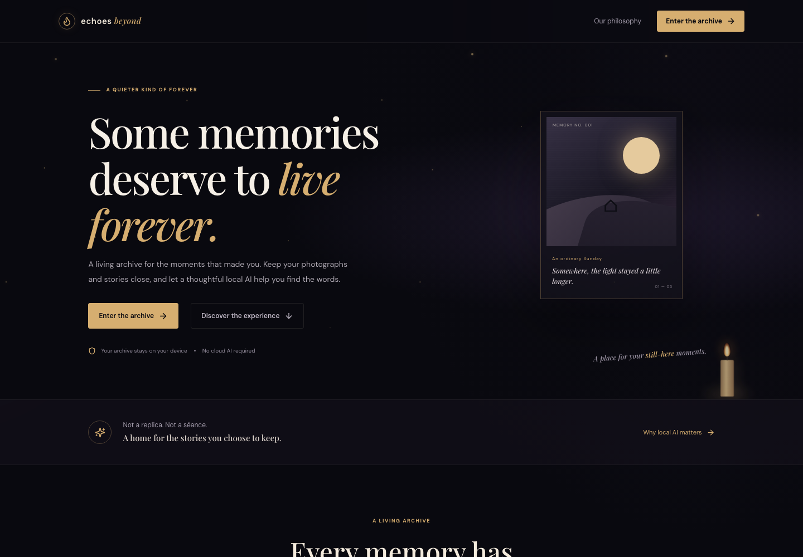
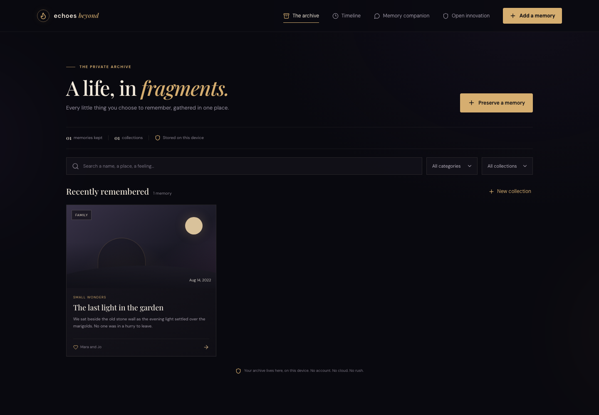
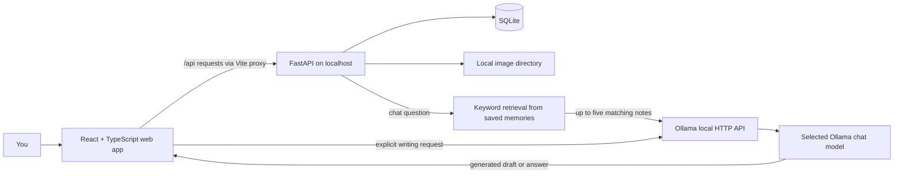

<div align="center">

# ECHOEVER

### Every Memory Deserves an Eternity.

**A private, local-first home for the moments you choose to keep.**

[](https://react.dev/)
[](https://www.typescriptlang.org/)
[](https://vite.dev/)
[](https://fastapi.tiangolo.com/)
[](https://sqlite.org/)
[](https://ollama.com/)
[](./LICENSE)

<br />

*Photographs fade. Stories get scattered. ECHOEVER gives them a place to return to.*

</div>

> **Branding note:** ECHOEVER is the project name used in this repository documentation. The current application UI and API still display their working name, **Echoes Beyond**; this README-only update does not rename the website.

## Contents

- [The idea](#the-idea)
- [Screenshots](#screenshots)
- [What you can do](#what-you-can-do)
- [How it works](#how-it-works)
- [Open-weight AI, kept close](#open-weight-ai-kept-close)
- [Technology](#technology)
- [Get started](#get-started)
- [Configuration](#configuration)
- [HTTP API](#http-api)
- [Data and privacy](#data-and-privacy)
- [Project structure](#project-structure)
- [Testing and production build](#testing-and-production-build)
- [Current scope and limitations](#current-scope-and-limitations)
- [Ghost in the Machine](#ghost-in-the-machine)
- [Contributing](#contributing)
- [License](#license)

## The idea

**ECHOEVER** is an AI-assisted digital memory archive for photographs, personal stories, and meaningful experiences. It helps you record a moment, keep related memories together, rediscover details through search or a timeline, and—when you choose—ask a local open-weight model to help shape your notes into words.

The archive is designed around a simple principle: **your memories belong to you**. Records and photographs are stored locally. There is no account, hosted AI provider, or required subscription. The AI is a writing and retrieval aid—not a person, a supernatural presence, or a source of facts about events you never recorded.

The current interface presents a dark, candlelit digital archive with animated transitions, atmospheric details, and a responsive layout. Its archive, editor, timeline, companion, and open-innovation screens use live data from the local API.

## Screenshots

The screenshots below are genuine captures of the running application. The archive screenshot contains a temporary illustrative memory used only to capture the interface; it is **not** preloaded or included in the database.

<p align="center">
  
  <br />
  <em>The landing page introduces the archive, local-first approach, and ways to enter.</em>
</p>

<p align="center">
  
  <br />
  <em>The archive brings searchable, filterable memories and collections together.</em>
</p>

## What you can do

### Preserve a memory

- Create and edit a memory with a title, date, notes, people, category, collection, and tags.
- Attach an optional JPEG, PNG, or WebP photograph and preview it before saving.
- Add notes by typing or, in supported browsers, using speech recognition.
- Keep each memory as written, or request an AI-generated story, title, caption, themes, or short remembrance.
- Review generated text before choosing whether to use it; it never replaces your notes automatically.

### Rediscover what you kept

- Browse memory cards in the archive and open a detail view to edit or delete a record.
- Search saved titles, descriptions, people, and tags.
- Filter by category or collection and create named collections, including empty ones.
- Explore a chronological timeline, filter it by year or category, and expand an entry to revisit its full memory.
- Ask the companion questions about saved notes. Relevant archive records are retrieved first, and matching memory IDs are shown with model-generated answers.

### Understand the local AI setup

The **Open Innovation** screen reports Ollama availability and whether the selected model is installed. It can switch between models reported by your Ollama instance and explains how to install a model locally.

## How it works



### A memory's path

1. The React editor submits a validated memory to the FastAPI service.
2. SQLAlchemy stores the record in SQLite. Tags are serialized as JSON text; an optional image is uploaded in a separate request and stored under a server-generated filename.
3. Archive searches and timeline filters query those local records through the API.
4. For a writing action, the API sends the supplied text and task prompt to the configured Ollama `/api/chat` endpoint.
5. For companion chat, the API first looks for matching saved memories and sends only those text excerpts—not photographs—to Ollama. If no match is found, the API returns a fixed “not found” response without asking the model to guess.

The app does not use embeddings, a vector database, LangChain, or a hosted AI API. Its current memory retrieval is a small keyword-overlap matcher; see [Current scope and limitations](#current-scope-and-limitations).

## Open-weight AI, kept close

Ollama provides the local inference boundary. The default model name is **`gemma3:4b`**, configurable through `OLLAMA_MODEL` or the Open Innovation screen. You can select another installed Ollama model that supports the chat API, including a compatible Qwen model. ECHOEVER does not download models automatically.

### Available AI tasks

The memory editor currently exposes these Ollama-backed actions:

| Task | What the prompt asks the model to do |
|---|---|
| `story` | Turn notes into a short first-person story without adding details |
| `title` | Suggest three short titles based on the notes |
| `caption` | Write one brief caption using only supplied context |
| `themes` | Identify a small set of explicitly supported themes |
| `poem` | Write a short remembrance without claiming contact with the dead |
| `chat` | Answer using only the retrieved archive excerpts |

The API also accepts `summary`, `connections`, and `questions` tasks. These additional prompts are available to API callers but do not currently have dedicated controls in the web interface.

The model is instructed not to invent real events or personal details, but prompt instructions cannot guarantee a model will always comply. Treat every generation as a **draft** and review it against your own memories before keeping it.

### A note on “local”

By default, the backend calls Ollama at `http://127.0.0.1:11434`, so memory text used for inference stays on the same machine. If you configure `OLLAMA_BASE_URL` to point elsewhere, the text sent for AI actions will go to that endpoint instead. Photos are not sent to Ollama by the app.

Once dependencies and a model are downloaded, the core archive and local inference do not require a cloud AI service. The UI optionally loads fonts from Google Fonts, and browser speech recognition may use the browser vendor's service. Use typed input and local/system fonts when you need to avoid those external services.

## Technology

| Layer | Technologies in this repository |
|---|---|
| Web application | React 18, TypeScript 5, Vite 8 |
| Styling and interaction | Tailwind CSS 3, custom responsive CSS, Framer Motion 11, Lucide React |
| API | Python, FastAPI, Pydantic 2, Uvicorn |
| Persistence | SQLAlchemy 2, SQLite |
| Image handling | Pillow; image files stored locally |
| AI runtime | Ollama `/api/chat`, configurable local chat model |
| Automated backend tests | pytest, FastAPI `TestClient`, isolated SQLite |

There is no frontend test runner configured in `package.json`; `npm run build` performs the TypeScript project build and Vite production build.

## Get started

### Prerequisites

- **Node.js 20.19+ or 22.12+** and npm.
- **Python 3.9+**.
- **Ollama** and at least one compatible model for AI features. The archive, collections, and timeline can be used without Ollama.

### 1. Configure and run the API

From the repository root:

```bash
cp .env.example .env
python3 -m venv .venv
source .venv/bin/activate
python -m pip install -r requirements.txt
python -m uvicorn backend.app.main:app \
  --env-file .env \
  --reload \
  --host 127.0.0.1 \
  --port 8000
```

The API initializes its SQLite tables at startup. The interactive API reference is available at [http://127.0.0.1:8000/docs](http://127.0.0.1:8000/docs).

### 2. Run the web app

In a second terminal, from the repository root:

```bash
npm install
npm run dev
```

Open the local URL printed by Vite (normally [http://localhost:5173](http://localhost:5173)). The development server proxies `/api` requests to `http://127.0.0.1:8000`.

### 3. Enable local AI

Install Ollama from [ollama.com](https://ollama.com), start its local service if it is not already running, and pull the default model:

```bash
ollama pull gemma3:4b
ollama list
```

Return to **Open Innovation** in the app and check the connection. Choose any model listed by Ollama if you prefer a different compatible model. Inference errors, an unavailable Ollama service, and an uninstalled selected model are reported rather than replaced with fabricated AI output.

## Configuration

Copy `.env.example` to `.env`. The backend reads the following settings when launched with Uvicorn's `--env-file .env` option:

| Variable | Default | Purpose |
|---|---|---|
| `DATABASE_URL` | `sqlite:///./data/echoes.db` | SQLAlchemy database URL. Relative SQLite paths resolve under the repository root. |
| `UPLOAD_DIR` | `./data/uploads` | Local directory for uploaded image files. |
| `OLLAMA_BASE_URL` | `http://127.0.0.1:11434` | Ollama-compatible API base URL. |
| `OLLAMA_MODEL` | `gemma3:4b` | Default model name; the app's saved model setting can override it. |
| `OLLAMA_TIMEOUT_SECONDS` | `120` | HTTP timeout for generation requests. |
| `MAX_UPLOAD_MB` | `8` | Maximum accepted image upload size in MiB. |
| `CORS_ORIGINS` | `http://localhost:5173,http://127.0.0.1:5173` | Comma-separated CORS origins allowed by FastAPI. |
| `APP_HOST` | `127.0.0.1` | Present in `.env.example` but not read by application code; configure the bind address with Uvicorn's `--host`. |
| `APP_PORT` | `8000` | Present in `.env.example` but not read by application code; configure the port with Uvicorn's `--port`. |

The Vite `/api` proxy target is currently configured in [`vite.config.ts`](./vite.config.ts) and defaults to `http://127.0.0.1:8000`.

## HTTP API

All routes are served under `/api`. Request and response schemas are defined in `backend/app/schemas.py`; FastAPI's interactive documentation is available at `/docs`.

| Method | Route | Purpose |
|---|---|---|
| `GET` | `/api/health` | Basic service health response |
| `GET` | `/api/memories` | List/search memories; supports `q`, `category`, `collection`, `year`, and `sort` query parameters |
| `POST` | `/api/memories` | Create a validated memory |
| `GET` | `/api/memories/{memory_id}` | Retrieve a memory |
| `PUT` | `/api/memories/{memory_id}` | Replace a memory's editable fields |
| `DELETE` | `/api/memories/{memory_id}` | Delete a memory and its attached image file |
| `GET` | `/api/collections` | List named and memory-associated collections |
| `POST` | `/api/collections?name=...` | Create a named collection |
| `POST` | `/api/memories/{memory_id}/image` | Upload an image as multipart form data in the `file` field |
| `GET` | `/api/images/{image_name}` | Serve an uploaded image by its generated filename |
| `GET` | `/api/timeline` | List memories chronologically; supports `year` and `category` |
| `POST` | `/api/ai/generate` | Generate a writing response or answer a retrieved-memory chat question |
| `GET` | `/api/ai/status` | Report Ollama availability, installed model names, and selected model readiness |
| `GET` | `/api/settings` | Read the saved model preference |
| `PUT` | `/api/settings` | Save a model preference |

`GET /api/memories` sorts by memory date descending by default. `sort=oldest` reverses that order; `sort=created` sorts by record creation time. Search checks title, description, people, and tags. Category and collection filters are exact matches; the year filter applies to the memory date.

### Create a memory

```bash
curl -X POST http://127.0.0.1:8000/api/memories \
  -H 'Content-Type: application/json' \
  -d '{
    "title": "The last light in the garden",
    "memory_date": "2022-08-14",
    "description": "We sat beside the old stone wall as the evening light settled.",
    "people": "Mara and Jo",
    "category": "Family",
    "tags": ["garden", "summer"],
    "collection": "Small wonders"
  }'
```

The required fields are `title`, `memory_date`, and `description`. `people`, `category`, `tags`, and `collection` have defaults. The response includes the memory ID, timestamps, normalized tags, and `image_url` when a photo is attached.

### Request a story draft

```bash
curl -X POST http://127.0.0.1:8000/api/ai/generate \
  -H 'Content-Type: application/json' \
  -d '{
    "task": "story",
    "text": "We sat beside the old stone wall as the evening light settled."
  }'
```

The response includes generated `text`, the `model` name, `sources` (memory IDs for chat), and a `generated` flag. If Ollama cannot be reached or returns an error, the endpoint responds with an error status instead of a pretend generation.

## Data and privacy

### Where data lives

By default:

- SQLite database: `data/echoes.db`
- Uploaded images: `data/uploads/`
- Table definitions: `backend/app/models.py`
- Request/response validation: `backend/app/schemas.py`

The `Memory` model stores title, date, description, people, category, JSON-encoded tags, collection name, generated image filename, and timestamps. A separate `Collection` table preserves named collections even when they contain no memories. `AppSetting` stores the selected Ollama model. These models do not define foreign-key relationships between collections and memories; a memory stores its collection name as text.

SQLite tables are created with SQLAlchemy `create_all()` when the API starts. This project does not currently include database migrations or a backup command. To back up an archive, stop the API and copy the database file and upload directory together.

### Image handling

Image uploads are checked using their actual image content, not only the browser's filename or MIME type. The default maximum file size is 8 MiB and images larger than 40 megapixels are rejected. Only JPEG, PNG, and WebP are accepted. The server generates random image filenames and serves files through the API.

### Privacy boundaries

- This is a **single-user local application** and does not implement authentication or authorization.
- The documented Uvicorn command binds to loopback (`127.0.0.1`). Do not expose the API or upload directory to a LAN or public network without adding appropriate access controls.
- Memory and photo files are stored locally, but any process or person able to access the local API or filesystem can access them.
- When you explicitly use an AI action, the relevant text is sent to the configured Ollama endpoint. With the default URL this is the local machine; a remote `OLLAMA_BASE_URL` changes that boundary.
- Optional dictation is implemented with browser speech recognition, which may send audio to the browser vendor's service. Typing avoids this feature.
- Google Fonts are referenced by the page and may be fetched from Google when online. System font fallbacks are used when they are unavailable.

## Project structure

```text
.
├── backend/
│   ├── app/
│   │   ├── ai.py                 # Ollama prompts, request handling, keyword retrieval
│   │   ├── config.py             # Environment-based backend configuration
│   │   ├── database.py           # SQLAlchemy engine, Base, and session dependency
│   │   ├── main.py               # FastAPI app and HTTP endpoints
│   │   ├── models.py             # Memory, Collection, and AppSetting tables
│   │   └── schemas.py            # Pydantic request and response models
│   └── tests/
│       └── test_api.py           # CRUD, retrieval, collection, and image API tests
├── docs/
│   └── screenshots/              # README screenshots of the running UI
├── src/
│   ├── api.ts                    # Typed fetch wrapper for the backend
│   ├── App.tsx                   # Landing, archive, studio, timeline, companion, about
│   ├── main.tsx                  # React entry point
│   ├── styles.css                # Responsive visual system and motion details
│   └── types.ts                  # Frontend data and view types
├── .env.example                  # Local configuration template
├── index.html                    # Vite HTML entry
├── package.json                  # Frontend scripts and dependencies
├── requirements.txt              # Backend and test dependencies
└── vite.config.ts                # Vite setup and local API proxy
```

## Testing and production build

Run backend tests from the repository root:

```bash
python -m pytest -q
```

The tests use an isolated in-memory SQLite database and temporary image storage. They cover memory CRUD and validation, search and timeline results, collection persistence, image validation/serving, archive-grounded chat sources, and the Ollama-unavailable error path. Ollama is not required for this suite.

Build and type-check the frontend:

```bash
npm run build
```

Preview the production build locally:

```bash
npm run preview
```

## Current scope and limitations

ECHOEVER is a working local application, but it is intentionally not presented as a deployed multi-user service. Current limitations include:

- **No accounts or authentication.** Keep the API on loopback.
- **Keyword retrieval, not semantic search.** Companion retrieval scores memory text by query-word overlap and returns up to five matches. It may miss related memories phrased differently; no vector index or embeddings are used.
- **No guarantee that an LLM follows its prompt.** The app asks the model not to invent details, but users should verify all generated stories, themes, captions, and answers.
- **No image understanding.** Photos are stored and displayed, but their contents are not sent to a vision model or interpreted by the companion.
- **Basic collections.** Collections are named groups; there is no separate collection detail page or richer nested organization.
- **No pagination or frontend test runner.** The archive currently loads filtered results as a list; automated tests cover the backend.
- **Some backend AI tasks are API-only.** `summary`, `connections`, and `questions` can be requested through `/api/ai/generate` but are not exposed as UI actions.
- **Voice dictation is browser-dependent.** It is optional and may use a remote browser speech service.
- **No migrations or export/import workflow.** SQLite tables are initialized on startup; backups currently require copying the database and image directory.

## Ghost in the Machine

ECHOEVER interprets the [Hacktoberfest Open-Source AI Challenge: Week 4](https://dev.to/challenges/hf26) theme, **“Ghost in the Machine,”** as a way to honor the memories and stories people choose to preserve—not as a claim that AI can contact or represent someone who has died.

Open-weight models and local inference are central to the experience: the archive remains on the user's device, model choice is configurable, and the AI can be run without a paid hosted inference provider. A challenge entry requires a DEV post using the official template and the `#hf26challenge` tag; this README does not itself submit the project.

## Contributing

Issues and pull requests are welcome. For changes to the application, please:

1. Keep private user data local by default.
2. Do not add a hosted AI dependency as the primary model path.
3. Preserve the boundary between saved facts and model-generated suggestions.
4. Add or update backend tests for new API behavior.
5. Run `python -m pytest -q` and `npm run build` before opening a pull request.

## License

Released under the [MIT License](./LICENSE).
